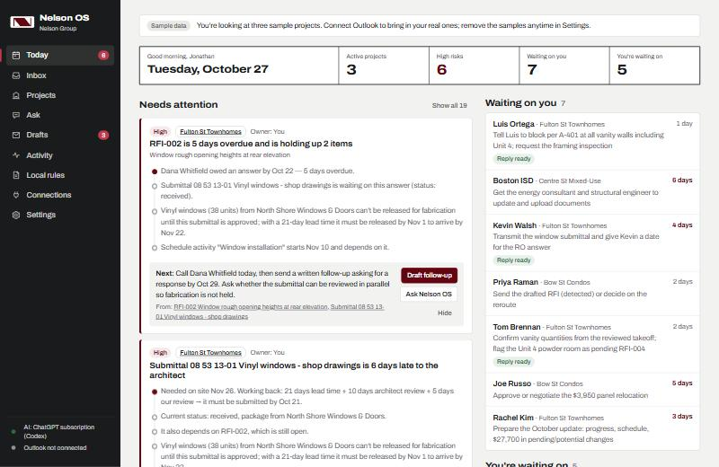
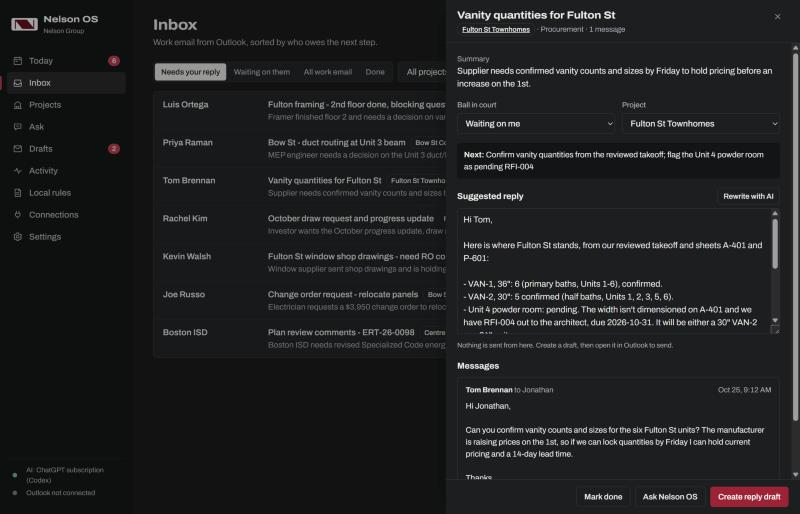

# Nelson OS

Construction operations for Nelson Group: one place to see every active project, what needs you today, who you're waiting on, and the RFIs, submittals, orders and replies that are ready to send.



## Install (for Jonathan)

Open Claude Code or Codex and paste the prompt in **[SETUP-PROMPT.md](SETUP-PROMPT.md)**. It installs everything, starts Nelson OS with the computer, puts an icon on the desktop, and opens a five-step setup window.

No Claude Code or Codex? Download this repo as a ZIP, unzip it, and double-click `install-windows.cmd` (Windows) or `install-mac.command` (Mac).

## What it does

**Today.** A briefing built like a drawing title block: active projects, high risks, who's waiting on you, and who you're waiting on. Every risk shows the chain of facts behind it and one recommended action with a button:

> RFI-002 is 5 days overdue and is holding up 2 items. Submittal 08 53 13-01 (windows) is waiting on it → North Shore can't release 38 windows for fabrication → with a 21-day lead time they must be released by Nov 1 → window installation starts Nov 10. **Next:** call Dana today, then send a written follow-up. **[Draft follow-up]**

**Inbox.** Outlook mail (read-only) sorted by who owes the next step, with project, summary, next action and a suggested reply. Example: a supplier asks for vanity quantities. Nelson OS answers from the *reviewed* takeoff and sheets A-401/P-601, and holds the Unit 4 count because RFI-004 is still open.



**Projects.** Per-project logs for RFIs, submittals (with computed submit-by and back-by dates), orders and takeoffs (release-by dates), schedule (six-week view with blocked activities in red), change orders and budget, permits and inspections, contacts, email and activity.

**Drawings.** Drop in PDF drawing sets and specs. Nelson OS reads every page, finds sheet numbers, and answers questions ("how many 30-inch vanities?") from the actual sheets with page citations.

**Send-ready paperwork.** One click makes a branded RFI form or submittal transmittal (PDF), plus an email to the architect or engineer that opens in Outlook with the PDF attached. Nothing is sent until the user presses Send in Outlook.

**Ask.** A chat agent with tools over everything above. It drafts replies, creates records, writes owner updates and three-week lookahead emails, and logs every action with its reason (Activity page).

**Local rules.** Massachusetts and Greater Boston requirements (780 CMR 10th edition, Specialized Energy Code dates, Boston work hours and off-hours permits, ISD permits, Dig Safe, CSL), each marked *checked against official sources* or *not verified*.

**Phone.** Turn on phone access in Settings (passcode + QR code). Off-site, use Tailscale.

## AI: use an existing subscription

| Engine | How it connects | Notes |
|---|---|---|
| **Claude** (Pro/Max) | Connect → browser sign-in (installs Claude Code if needed) | Full agent; reads drawing pages |
| **ChatGPT** (Plus/Pro) | Connect → browser sign-in (installs Codex if needed) | Full agent; drawing answers from extracted text |
| Claude API key | Paste key | Fastest; native PDF vision with page citations |
| None | — | Rules-based sorting and search still work |

Subscription engines run the same Nelson OS tools through the bundled MCP server, so the agent behaves the same on every engine.

## One-time step for Gustavo: Microsoft app

Outlook sign-in needs a Microsoft app registration (5 minutes, no secret). Follow **[docs/MICROSOFT-APP.md](docs/MICROSOFT-APP.md)**, put the client ID in `config/defaults.json`, and push. Until then, the Outlook tile shows a guided setup panel.

## Security and data

- Runs only on the user's computer (`localhost`). Phone access is opt-in and passcode-protected.
- Outlook access is read-only (`Mail.Read`, `Calendars.Read`). No send, write or delete permissions.
- OAuth tokens and API keys are encrypted at rest (Windows DPAPI / macOS Keychain).
- Requests are checked for host (DNS-rebinding guard) and a custom header (CSRF guard).
- Data lives outside the repo: `%LOCALAPPDATA%\NelsonOS` (Windows) or `~/Library/Application Support/NelsonOS` (Mac). Backups: Settings → Download a backup.
- Items found automatically in email are marked **Found in email** until a person confirms them.

## For developers

```
npm install
npm run server        # http://localhost:4780
npm test
```

Node 22.13+, Express 5, built-in `node:sqlite` (FTS5 search), Preact + htm without a build step, pdf.js for page text, pdf-lib for forms, `@anthropic-ai/sdk`, `@modelcontextprotocol/sdk`.

```
server/
  index.js            routes, security, sync scheduler
  ai/                 engine (API / Claude Code / Codex), agent loop, tools, prompts
  domain/             risk engine, briefing, forms (RFI, transmittal, .eml), MA/Boston rules
  sync/               Microsoft OAuth + Graph, Outlook sync, email triage
  docs/pdf.js         drawing index + Q&A
mcp/server.js         MCP server for Claude Code, Codex, Claude Desktop
scripts/              setup, launch, update, uninstall, shortcuts and start-on-sign-in
public/               the app (no build step)
```

Update: `node scripts/update.mjs` · Uninstall: `node scripts/uninstall.mjs`
